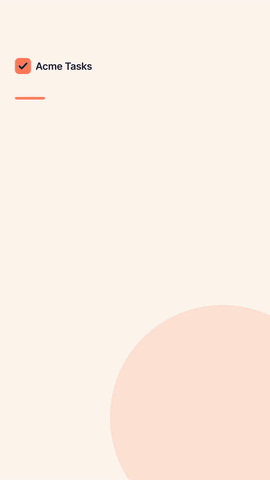
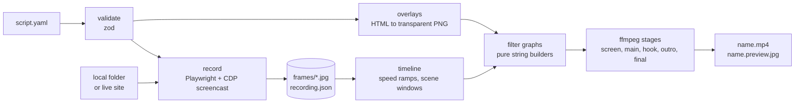

# reels-factory

Write a short YAML script, get a vertical reel of your web app.

`reels-factory` opens your page in a phone-sized Chromium, performs the taps, typing and scrolling
you describe, and records every repaint. Then it edits the footage with ffmpeg into a 1080x1920
H.264 + AAC video: an animated hook card, the screen inside a phone frame with a caption per scene,
fast-forwarded waits, and an outro card with your call to action. Text always stays inside the
area that Instagram Reels and TikTok leave uncovered.

<p align="center">
  
</p>

The GIF above is the bundled example, rendered on a laptop in about 30 seconds. Nothing in it was
edited by hand.

## Why

Screen-recorded shorts are the cheapest marketing a small product can make, and the most tedious.
Every reel needs the same chores: a clean phone recording, a visible finger so viewers can follow
the taps, dead time cut out, captions that do not collide with the platform buttons, a hook and an
outro in your colors. When the UI changes, you do it all again.

`reels-factory` turns those chores into a script you can keep in your repo, review in a pull
request and re-run after every release.

## Quickstart

Requirements: Node.js 22+, ffmpeg 7+ on `PATH`.

```sh
git clone https://github.com/leonardo-carnevalli/reels-factory.git
cd reels-factory
npm install
npx playwright install chromium   # one-time browser download
npm run dev -- doctor             # checks Node, ffmpeg and Chromium

npm run example                   # records examples/demo-site and writes out/demo/demo.mp4
```

The example serves `examples/demo-site/index.html` on a local port, so it needs no network and no
account anywhere. Open `out/demo/demo.preview.jpg` for a four-frame contact sheet of the result.

To build the CLI and use it as `reels-factory`:

```sh
npm run build && npm link
reels-factory make examples/demo.reel.yaml
```

## Commands

| Command             | What it does                                                       |
| ------------------- | ------------------------------------------------------------------ |
| `make <script>`     | `record`, then `render`. The one you will use most.                |
| `record <script>`   | Runs the steps in Chromium and saves frames plus `recording.json`. |
| `render <script>`   | Edits the last recording into `<out>/<name>.mp4`.                  |
| `validate <script>` | Checks the script without opening a browser.                       |
| `doctor`            | Checks Node.js, ffmpeg and the Chromium download.                  |

Options: `-o, --out <dir>` (default `out/<script name>`), `--guides` (paints the safe zone on the
video so you can check a layout), `--json` (machine-readable result on stdout), `-q, --quiet`,
`-v, --verbose` (every step, every ffmpeg command, stack traces).

Splitting `record` from `render` matters in practice: recording drives a real browser and takes as
long as the scenario, while rendering is deterministic. Tweak captions, colors or `rate` and run
`render` again without touching the site.

Exit codes are stable so scripts and CI can rely on them:

| Code | Meaning                               |
| ---- | ------------------------------------- |
| 0    | Success                               |
| 1    | A step or an ffmpeg stage failed      |
| 2    | Bad usage or invalid script           |
| 3    | ffmpeg or Chromium missing or too old |

Every error says what to do next, for example:

```text
error invalid broken.reel.yaml
  steps[1].clik: unknown action "clik". Did you mean "click"? Actions: goto, click, type, scroll, wait, waitFor, caption
  fix: see the script format in the README (section 'Script reference')
```

## Script reference

A script is YAML (or JSON). Relative paths resolve from the script's folder.

```yaml
name: demo # output file name; defaults to the script file name
serve: ./demo-site # serve a local folder... (or)
# baseUrl: https://staging.example.com  # ...record a running site
brand: ./brand/brand.yaml # file path or an inline mapping, see below
viewport: { width: 390, height: 844, scale: 2 } # CSS pixels and device scale
rate: 1.1 # plays the whole recording 1.1x faster
hide: ["#cookie-note"] # selectors hidden while recording
music: { file: ./track.mp3, volume: 0.6, start: 12 } # optional; silent AAC otherwise

hook: # opening card
  kicker: New app
  title: ["Plan your day", "in 3 taps"] # 1 to 3 lines; with 2+ the last is in the accent color
  duration: 1.8

outro: # closing card
  title: ["Try it", "today"]
  subtitle: One line on what to do next.
  cta: Link in bio
  duration: 3

steps:
  - goto: /
  - caption: { title: ["Add a task", "in seconds"], subtitle: Type it, tap Add, done. }
  - type: { selector: "#new-task", text: "Book the dentist" }
  - click: "#add"
  - waitFor: "#plan-result"
    fit: 1 # however long this takes, it lasts 1 second in the video
```

### Steps

Each step has exactly one action. Selectors are
[Playwright selectors](https://playwright.dev/docs/locators): CSS, `text=Add`, `role=button[name="Add"]`.

| Action    | Short form         | Full form                                | Notes                                       |
| --------- | ------------------ | ---------------------------------------- | ------------------------------------------- |
| `goto`    | `goto: /pricing`   |                                          | Relative to `baseUrl` or the served folder. |
| `click`   | `click: "#save"`   | `{ selector, pause: 150 }`               | Fingertip glides in, ripple, press, click.  |
| `type`    |                    | `{ selector, text, delay: 55 }`          | Taps the field, then types key by key.      |
| `scroll`  | `scroll: 600`      | `{ to: 600 \| "#stats", duration: 900 }` | Eased scroll to a pixel offset or element.  |
| `wait`    | `wait: 800`        |                                          | Milliseconds.                               |
| `waitFor` | `waitFor: "#done"` | `{ selector, timeout: 15000 }`           | Waits until the element is visible.         |
| `caption` | `caption: "Title"` | `{ title: [line, line], subtitle }`      | Starts a new scene with this caption.       |

Any step also accepts:

- `speed: 4` plays that step four times faster (typing, long animations).
- `fit: 1.5` squeezes the step into 1.5 seconds of video, whatever it took live (network calls,
  AI responses). Use one or the other, not both.
- `optional: true` logs a warning and keeps going if the step fails, instead of stopping.

When the first step is a `goto`, the page loads before recording starts, so the reel never opens
on a blank screen. If a required step fails, the recorder saves `failed-step.png` next to the
output so you can see what the page looked like.

### Brand

```yaml
name: Acme Tasks # shown next to the logo; may be empty
logo: ./logo.svg # SVG, PNG or JPG
colors:
  background: "#1b1f3b" # behind the phone during screen scenes
  accent: "#ff7a59" # highlighted title line, tap ripple, call to action
  text: "#ffffff" # caption text
  frame: "#0d0f1f" # phone bezel
  card: "#fff4ee" # hook and outro background
  cardText: "#1b1f3b" # text on the cards
font:
  family: Inter # falls back to the system UI font when it is not installed
  file: ./fonts/Inter-Bold.woff2 # optional; embed it for identical output on every machine
```

Every field has a neutral default, so `brand` can be left out entirely while you prototype.

## Architecture



The code follows that picture:

| Module                   | Responsibility                                                     |
| ------------------------ | ------------------------------------------------------------------ |
| `src/script/`            | Schema, shorthand expansion, readable errors, path resolution.     |
| `src/record/`            | Static server, injected fingertip script, step runner, screencast. |
| `src/recording.ts`       | The `recording.json` contract between the two halves.              |
| `src/render/timeline.ts` | Time map for speed ramps and `rate`, concat list, scene windows.   |
| `src/render/layout.ts`   | Canvas, safe zone, phone screen placement.                         |
| `src/render/graph.ts`    | Every ffmpeg filter graph and argument list, as pure functions.    |
| `src/render/overlays.ts` | Draws captions, cards, background and bezel in Chromium.           |
| `src/render/pipeline.ts` | Runs the stages and keeps each graph and log in `<out>/build/`.    |

## Design decisions

**Screencast frames instead of a video capture.** Playwright's built-in video is fixed at CSS
resolution and a constant frame rate. The Chrome DevTools screencast delivers a JPEG per repaint at
full device resolution (390x844 at 2x is 780x1688), each with a timestamp. Holding each frame until
the next one gives a sharp image and an exact clock, and idle moments cost nothing.

**Speed ramps live on the recording clock.** The recorder only notes "from 4.2s to 7.9s, play 3.7x
faster". `createTimeMap` turns all ramps plus the global `rate` into one monotonic function, and
both the frame durations and the caption timings go through it. That is why captions stay in sync
no matter how much is fast-forwarded.

**Text is drawn by a browser, not by `drawtext`.** Captions and cards are HTML rendered to
transparent PNGs, then animated by ffmpeg overlays. You get real font shaping, emoji, kerning and
a shrink-to-fit pass that guarantees a long title never leaves its box.

**Filter graphs are pure functions.** Everything that decides the edit, from offsets and fades to
easing and input order, is a string builder with unit tests. ffmpeg only executes. A test also
checks that every graph is well formed (no label used before it exists), which catches most
mistakes before a 30 second render does.

**Stages, not one giant command.** Screen clip, composited main part, hook, outro and final join
are separate ffmpeg runs. Each writes its graph and log to `<out>/build/`, so a failure points at
one small, readable file. The cost is a few seconds of re-encoding at high quality (CRF 14 to 18).

**Silent AAC by default.** Platforms reject or mishandle videos without an audio track. Without
`music`, the final stage muxes generated silence, so the file uploads cleanly and you can still
add a trending sound in the app.

**Safe zone first.** `layout.ts` defines one rectangle (x 60 to 960, y 220 to 1500) that clears the
top bar, the caption area and the right-hand action column on both Reels and TikTok. Captions are
laid out inside it and the layout tests assert that. Run `render --guides` to see it.

**Fast to start.** Playwright is imported lazily, so `--help` and `validate` do
not pay for a browser.

## Development

```sh
npm run lint        # ESLint (strict, type-checked) and Prettier
npm run typecheck
npm test            # vitest: schema, timeline, layout, graphs, ffmpeg detection
npm run build       # compiles to dist/
```

CI runs the same commands on every push and pull request. Rendering needs ffmpeg and a browser,
so it stays out of CI; the pure modules it relies on are covered by the tests.

To refresh the GIF after changing the example:

```sh
npm run example
ffmpeg -i out/demo/demo.mp4 -vf "fps=12,scale=270:-2:flags=lanczos,split[a][b];[a]palettegen=max_colors=96:stats_mode=diff[p];[b][p]paletteuse=dither=bayer:bayer_scale=4" docs/demo.gif
```

## Limits

- Chromium only. The recording is a mobile viewport with touch enabled, not a real device.
- Sites behind a login need a `goto` to a page that is already accessible, or your own steps to
  sign in. Use a demo account with fake data: whatever is on screen ends up in the video.
- The phone screen can extend under the platform UI at the very bottom. Text never does.

## License

[MIT](LICENSE) © 2026 Leonardo Carnevalli
